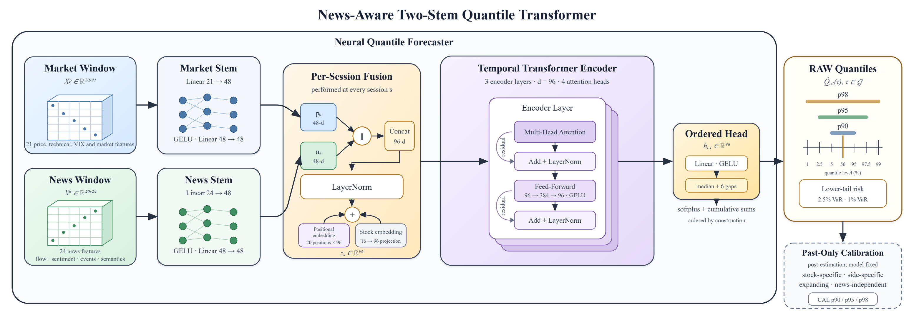

<h1 align="center">Financial News-Informed Quantile Forecasting<br>of Stock Return Intervals</h1>

<p align="center">Yavuz Serdar Koçyiğit · İlknur Karadeniz · Olcay Taner Yıldız</p>

<p align="center">Research code for next-session stock-return intervals from market history and financial news.</p>

<p align="center">
  <a href="#quick-start"></a>
  <a href="requirements.txt"></a>
  <a href="LICENSE"></a>
</p>

<p align="center">
  <a href="#overview">Overview</a> ·
  <a href="#main-results">Results</a> ·
  <a href="#quick-start">Quick start</a> ·
  <a href="#reproducing-the-paper">Reproduction</a> ·
  <a href="#data-availability">Data</a> ·
  <a href="#license">License</a>
</p>

## Overview

How much does financial news add to a stock's next-session return interval?
This study compares a news-aware quantile Transformer with an otherwise identical model trained without news,
using **456 U.S. stocks and SPY** over the **2020–2025** out-of-sample period.

The model combines a **20-session market window** with **24 session-level news features** derived from
firm-specific Benzinga articles. Separate market and news stems feed a shared Transformer, which predicts
seven ordered quantiles of the next session's close-to-close log return. A stock-specific, past-only
conformal-style calibration step then adjusts interval coverage.

<p align="center">
  
</p>

*Model architecture from the accompanying manuscript. The forecasting model stays fixed during testing;
calibration updates only as past outcomes become available.*

- **Ordered intervals:** Seven quantiles are non-crossing by construction before calibration.
- **News beyond sentiment:** Features capture sentiment, semantic change, news flow, event content, and availability/attribution.
- **Controlled comparisons:** News and no-news models share the architecture, chronological splits, and training settings.

## Main results

For calibrated **95% prediction intervals**, the contribution of news is concentrated on sessions preceded
by predefined event-related news. The Winkler score jointly evaluates coverage and interval width; lower is better.

| Evaluation scope | Winkler change vs. no news | Bootstrap 95% CI |
|:---|---:|---:|
| All sessions | **−4.5%** | [−6.0%, −3.0%] |
| Event sessions | **−15.9%** | [−19.4%, −12.3%] |
| Non-event sessions | −0.2% | [−0.8%, +0.4%] |

*Reported paper results for 457 assets and 689,156 test stock-sessions, using three training seeds.
Changes use paired daily losses; confidence intervals use a moving-block bootstrap over dates.
The non-event difference is not statistically significant. Non-event sessions may contain other news.*

News also changes how interval width is allocated across sessions and between the downside and upside.
A content-placebo control retains a performance advantage over the no-news model on event sessions,
while correctly aligned news content provides an additional improvement.

## Quick start

Tested with **Python 3.10** and **PyTorch 2.5.1**. A CUDA GPU is recommended for training, FinBERT scoring,
and the LLM baseline. GPU execution is not bit-reproducible because some cuDNN and scatter kernels are
non-deterministic; numerical results can vary across runs and hardware.

```bash
git clone https://github.com/yavuzserdarkocyigit/Financial-News-Informed-Quantile-Forecasting-of-Stock-Return-Intervals.git
cd Financial-News-Informed-Quantile-Forecasting-of-Stock-Return-Intervals
python -m pip install -r requirements.txt
```

**Prepare the inputs first:** the repository contains the ticker lists and collection scripts, not the
underlying market/news data or trained artifacts. Follow [Data availability](#data-availability) and
[the input specification](data/README.md) before building features.

Once the inputs are available, run a news/no-news comparison with one seed:

```bash
python src/news_features.py
python src/dataset.py
python src/train.py --seed 7
python src/train.py --seed 7 --no-news
```

The full paper uses seeds **7, 42, and 123**. The commands below reproduce the complete experiment workflow.
Shell examples use Bash, including `export` and `for` loops.

## Reproducing the paper

| Setting | Paper configuration |
|:---|:---|
| Training / validation / test | 2010–2017 / 2018–2019 / 2020–2025 |
| Input window | 20 sessions; 21 market features and 24 news features |
| Transformer | Dimension 96; 3 encoder layers; 4 heads; dropout 0.10 |
| Trainable parameters | 363,527 |
| Quantile levels | 0.01, 0.025, 0.05, 0.50, 0.95, 0.975, 0.99 |
| Training seeds | 7, 42, 123 |

<details>
<summary><strong>1. Build features and train both model variants</strong></summary>

```bash
python src/news_features.py
python src/dataset.py
for s in 7 42 123; do
  python src/train.py --seed $s
  python src/train.py --seed $s --no-news
done
```

</details>

<details>
<summary><strong>2. Evaluate coverage, interval quality, width allocation, and downside risk</strong></summary>

```bash
python src/data_summary.py       # Table IV: sample composition
python src/evaluate.py           # Table V: raw and calibrated intervals
python src/paired_stats.py       # Table VI, Tables S5–S6: paired news effects
python src/widths.py             # Table VII: width reallocation
python src/var_backtest.py       # Fig. 4: Value-at-Risk breach rates
```

</details>

<details>
<summary><strong>3. Run feature-group ablations</strong></summary>

Print the required dataset and training commands, run those commands, then summarize the results:

```bash
python src/ablation.py --commands
# Run the dataset/training commands printed above before summarizing.
python src/ablation.py           # Table VIII and Table S7
```

</details>

<details>
<summary><strong>4. Run the content-placebo control</strong></summary>

Selected content features are shuffled within each stock and data split while news-flow and
availability features remain fixed. Retrain the placebo models before comparing their forecasts.

```bash
python src/placebo.py
python src/dataset.py --news-dir artifacts/news_placebo --out artifacts/dataset_placebo.pt
for s in 7 42 123; do
  python src/train.py --data artifacts/dataset_placebo.pt --arm placebo --seed $s
done
python src/paired_stats.py --arms placebo,nonews --stages cal
python src/paired_stats.py --arms news,placebo --stages cal
python src/figures.py            # Figs. 2–4 and Table S8
```

Table S9 reports the magnitude comparisons; Table S8 reports band asymmetry under the original sentiment labels.

</details>

<details>
<summary><strong>5. Evaluate the zero-shot LLM baselines</strong></summary>

```bash
python src/llm_baseline.py --model Qwen/Qwen3-1.7B
python src/llm_baseline.py --model google/gemma-3-1b-it
python src/llm_baseline.py --model meta-llama/Llama-3.2-1B-Instruct --accept-sorted
```

These commands produce the comparison reported in Table IX. Access to gated model weights, where
required by the model provider, must be arranged separately.

</details>

## Data availability

Price data from **Yahoo Finance** and VIX observations from **FRED** are public. **Benzinga news is licensed**
and requires your own API access. Raw articles and text-derived artifacts—including FinBERT scores,
news features, datasets, and predictions—are not distributed in this repository.

The input paths and expected article fields are documented in [data/README.md](data/README.md).
The panel and LLM ticker lists are included in `data/`.

<details>
<summary><strong>Download market/news inputs and compute FinBERT scores</strong></summary>

```bash
python src/data_collection/prices.py
python src/data_collection/vix.py
# Set your Benzinga news API endpoint and key in your environment.
export BENZINGA_API_URL=...
export BENZINGA_API_KEY=...
python src/data_collection/benzinga.py
python src/data_collection/finbert_scores.py
```

</details>

## Repository layout

<details>
<summary><strong>Source files and their corresponding paper results</strong></summary>

```text
src/
  config.py              Paths, splits, and quantile levels
  data_collection/       Market/news collection and FinBERT scoring
  news_features.py       24 session-level news features per stock
  dataset.py             Pooled windows and per-stock standardization
  model.py               Two-stem quantile Transformer and pinball loss
  train.py               Training and quantile predictions
  calibration.py         Past-only calibration and Winkler score
  evaluate.py            Coverage, width, and Winkler          (Table V)
  paired_stats.py        Paired news comparisons              (Table VI, S5–S6, S9)
  widths.py              Width reallocation                   (Table VII)
  ablation.py            Feature-group ablations              (Table VIII, S7)
  placebo.py             Content-placebo features             (Tables S8–S9)
  var_backtest.py        Value-at-Risk breach rates           (Fig. 4)
  llm_baseline.py        Zero-shot LLM forecasts              (Table IX)
  figures.py             Paper figures and band asymmetry     (Figs. 2–4, S8)
  data_summary.py        Sample composition and corpus size   (Table IV)
assets/                  README illustrations
data/                    Input specification and ticker lists
artifacts/               Generated outputs; not tracked
```

</details>

## License

The code is released under the [MIT License](LICENSE). This license does not cover the Benzinga articles
or artifacts derived from them, which remain subject to Benzinga's terms.
